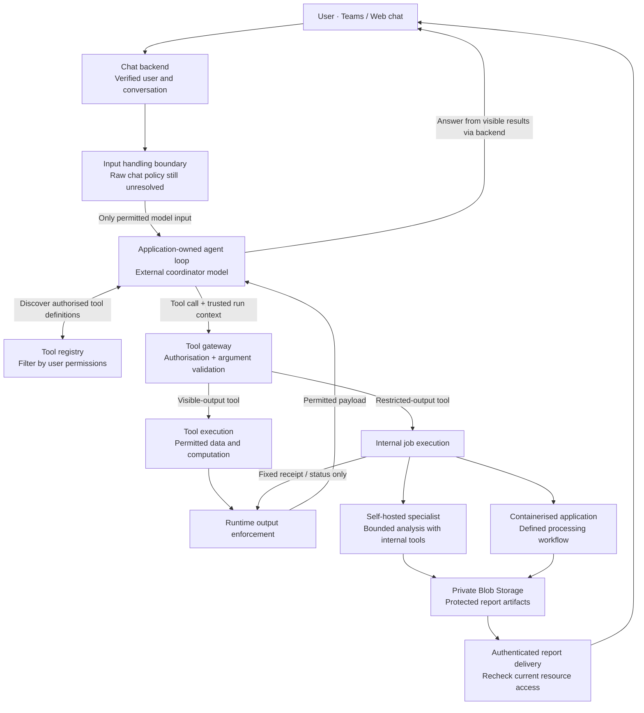

# Proposed architecture

Design snapshot: 27 October 2026. This is a proposed design, not implemented
behaviour or Rabobank's confirmed architecture. No services are deployed.

## Runtime and model roles

A general-purpose chat interface uses a powerful external model for conversation,
planning, tool discovery and reasoning over permitted results. The application
owns the agent loop and selects model-visible tools per request. The proposed
hosting target is Microsoft Foundry Hosted Agents; framework, SDK and deployment
compatibility remain to be validated.

A smaller, self-hosted open-weights model handles bounded tasks involving restricted
data. Its intended benefit is lower hosting cost; capability and cost require
measurement. Deterministic applications perform well-defined work and calculations
without requiring a model. The external coordinator remains useful for general
reasoning, but cannot interpret or refine restricted findings it never receives.
Such reasoning must happen internally or through the user's interaction with the
protected result.

## Request and result flow

Arrows show logical data flow, not every network call. The backend delivers report
links directly into the authenticated chat experience. Restricted content and
report links need not pass through the external coordinator. Durable workflow
tracking surrounds asynchronous execution; it carries opaque references rather
than raw restricted payloads.

## Permission-based tool discovery and execution

The user's enterprise permissions determine the tools available to the runtime.
A small initial tool set can expand through discovery as the request develops.
The registry returns only authorised tool definitions and safe descriptions;
the coordinator chooses relevant tools from that set. Prompt classification does
not grant permissions, and additional discovery does not require a new deployment.

Every call is independently checked at execution time. The gateway validates
arguments, tool and operation permissions, resource access and any required
approval using verified user, tenant and run context. Identity is never accepted
from model-generated arguments. An invented tool name or stale discovery result
cannot bypass these checks. Tool services also enforce access so that possession
of an agent service identity is insufficient.

Approval requirements belong to operation policy and the user's permissions.
Ordinary authorised operations can execute seamlessly; consequential operations
may require approval bound to their exact parameters. A permitted tool call does
not automatically establish that a requested action reflects the user's intent.

## Tool output policies

Each registered operation has a trusted, versioned output policy. The runtime
enforces that policy; neither the coordinator nor a tool's free-form response can
choose to expose restricted content.

| Output policy | What the coordinator receives | Processing and delivery |
| --- | --- | --- |
| Visible | Validated, permitted result data. | The coordinator can reason over results, request further computation and answer the user. Public data analysis is one example. |
| Restricted | An allowlisted receipt such as an opaque job ID and fixed status; sanitised error codes on failure. | Internal processing produces a protected artifact, delivered directly to the user through an authenticated report route. |

Visible output must be permitted for the external model, not merely readable by
the user. Mixed or uncertain payloads remain restricted. Metadata, filenames,
errors and summaries can also disclose information; fixed status fields must not
be populated from arbitrary worker text. Restricted artifacts cannot later be
read through a visible-output tool to bypass their policy.

Restricted operations have two execution options behind the same interface:

1. **Internal specialist:** a smaller self-hosted open-weights model uses bounded,
   authorised internal tools to analyse data, with code performing calculations
   where appropriate. It writes results to private storage for report generation.
2. **Containerised application:** a defined application performs the processing
   and writes a report artifact without involving a model.

Both paths keep raw data, intermediate results, specialist conversations and report
contents outside the external model's context. Completion sends a minimal status
to the coordinator and a protected link to the user. The delivery backend requires
an authenticated session and rechecks current access on every report request;
an opaque ID or possession of the link does not grant access.

## Security and execution boundaries

- Keep business credentials out of the external coordinator. Use managed
  identities and narrowly scoped service access; the coordinator has no route
  or credentials that bypass the gateway and output enforcement.
- Restricted workers have no unrestricted outbound access. Explicitly allow
  required internal model, data and Blob Storage endpoints. Literal zero egress
  would prevent those operations; no external model or telemetry destination
  may receive restricted data.
- Treat prompts, retrieved content, tool results and model output as untrusted.
  Tool availability does not authorise arbitrary code execution or unrestricted
  filesystem/network access. Computation tools need bounded execution and the
  same data and output policies as other tools.
- Keep restricted content out of external traces, exceptions, workflow histories,
  queues and conversation state. Audit verified identities, operations, policy
  decisions and approved references rather than raw payloads.
- Persist asynchronous job state, support cancellation and use idempotency keys
  to prevent duplicate side effects. Recheck permissions after waits and before
  execution and delivery. Bound concurrent work and serialize conversation
  updates without assuming a permanently running process.
- Enforce output policy on success, failure, streaming and retry paths. Internal
  workers cannot return unrestricted text through receipts or status messages.

## Decisions still open

1. **Raw chat input:** tool-output restrictions do not protect sensitive text or
   attachments submitted by the user. Detection and redaction are fallible; no
   reliable general-purpose sensitivity classifier is assumed. Decide whether
   raw input stays internal or the interface permits only externally processable
   input, and establish the enforcement and residual risks before deployment.
2. **Runtime and durability:** validate the Hosted Agents implementation path and
   dynamic tool selection. Define ownership between runtime/session state and
   Durable Functions job orchestration; add Service Bus if separate dispatch is
   needed. Do not assume retries provide exactly-once side effects.
3. **Tool policies:** define registry schemas, enterprise entitlement mappings,
   resource checks, approval rules and visible-result schemas. Specify how
   permissions and policy revisions affect active runs and pending jobs.
4. **Internal execution:** choose a specialist model and compute after measuring
   bounded-task quality, cost and capacity. Define which tools use deterministic
   applications, report generation and internal validation of model findings.
5. **Data and deployment policy:** confirm permitted data classes, external model
   processing/retention, internal network boundaries, storage retention and audit
   requirements. These are proposed constraints, not verified Rabobank policies.

## References

- [Foundry Agent Service](https://learn.microsoft.com/en-us/azure/foundry/agents/overview)
- [Deploy your own code as a hosted agent](https://learn.microsoft.com/en-us/azure/foundry/agents/quickstarts/quickstart-deploy-own-code)
- [Agent Framework and Foundry integration](https://learn.microsoft.com/en-us/agent-framework/integrations/by-component/agent-services/foundry)
- [Foundry networking](https://learn.microsoft.com/en-us/azure/foundry/agents/concepts/agents-networking-deep-dive)
- [Foundry data handling](https://learn.microsoft.com/en-us/azure/foundry/agents/data-privacy-security)
- [Hosted-agent resilience](https://learn.microsoft.com/en-us/azure/foundry/agents/concepts/long-running-agent-resilience)
- [Durable Task execution model](https://learn.microsoft.com/en-us/azure/azure-functions/durable/durable-functions-types-features-overview)

Feature availability, deployment regions and SDK compatibility must be verified
when implementation begins. No security, reliability or cost claims have been
validated by this scaffold.
