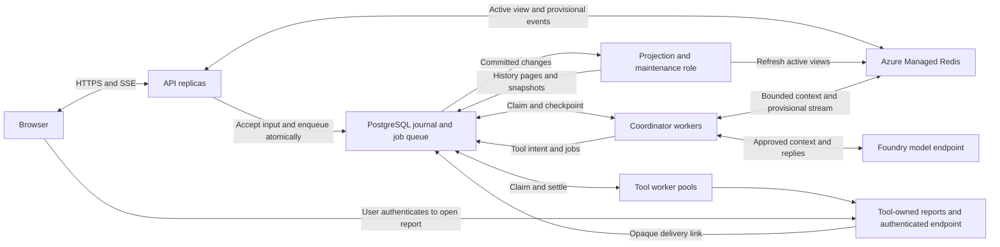
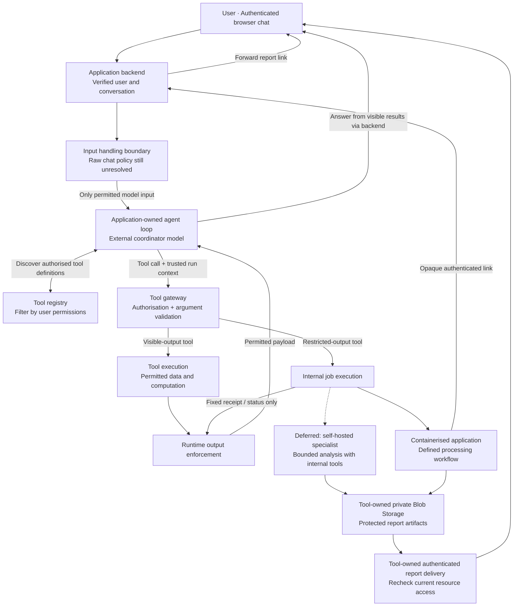

# Proposed architecture

Design updated: 2 November 2026. PostgreSQL conversations and durable queues,
with Redis for active sessions, replace the earlier Durable Task Scheduler choice.
This document specifies the target design. The
[PostgreSQL journal and synthetic job-record adapter](src/bankeriq_agent_platform/storage/README.md)
is implemented and locally validated. Redis sessions and synthetic durable workers
are implemented; real queued coordinator/tool execution and hosted scaling remain future work.
The completed runtime milestone at
`2fa515b` and local container evidence remain in [build-order/README.md](build-order/README.md).

## Runtime and model roles

A general-purpose chat interface uses a powerful external model for conversation,
planning, tool discovery and reasoning over permitted results. The application
owns the agent loop and selects model-visible tools per request. Foundry supplies
model inference. For the asynchronous queue design, Azure Container Apps is the
recommended execution host for API, coordinator and tool workers. This changes
the earlier Foundry Hosted Agents target and remains a hosting proposal to settle
before deployment. The existing Foundry hosting adapter and its validation work
are preserved; hosting compatibility is a separate gate below.

A smaller, self-hosted open-weights model is deferred to a later phase for bounded
tasks involving restricted data. Its intended benefit is lower hosting cost; capability and cost
require
measurement. Deterministic applications perform well-defined work and calculations
without requiring a model. The external coordinator remains useful for general
reasoning, but cannot interpret or refine restricted findings it never receives.
Such reasoning must happen internally or through the user's interaction with the
protected result.

Initially, restricted processing uses deterministic applications; workloads that
require the specialist remain unsupported. See [components.md](components.md) for
logical responsibilities, including durable execution and persisted state.

## Provider boundaries

Microsoft Foundry remains the initial model provider and the existing hosting
adapter. Core runtime components depend on `ModelClient`, `StateStore` and
execution/policy interfaces.
Provider SDKs, credentials and wire formats belong under
`src/agent_runtime/providers/<provider>/`.

Application startup selects model access and hosting independently through trusted
configuration. A registered model factory supplies `ModelClient`; a hosting
factory exposes `RuntimeEndpoint`. The model and request payloads cannot expand
the registered provider choices. Unsupported choices fail explicitly, and the
runtime does not automatically fall back to another data-processing provider.

Foundry is currently the only real implementation. Another provider adds an
adapter and startup registration while reusing the coordinator, tool registry,
gateway and output policy. See the
[provider guide](src/agent_runtime/providers/README.md) for implemented selection,
optional SDK dependencies and local validation evidence.

## Selected state and execution services

- **Durable state and dispatch**
  Selected service: Azure Database for PostgreSQL Flexible Server
  Ownership: Conversation journal and snapshots, runs, jobs, leases, retries, approvals and
  deduplication.

- **Active sessions**
  Selected service: Azure Managed Redis
  Ownership: Main API read path for recent history, context and progress; pending display state and
  transient streams.

- **Execution**
  Selected service: Azure Container Apps, proposed
  Ownership: Independently scalable API, coordinator and tool worker pools; maintenance starts as a
  bounded worker role.

- **Model inference**
  Selected service: Microsoft Foundry
  Ownership: Permitted context and tool schemas through the existing provider boundary.

- **Shared system prompts**
  Selected service: PostgreSQL versions and active binding; Redis caches immutable bodies
  Ownership: All sessions inherit the active global prompt at each new model step. Business overlays
  are deferred.

- **Confidential reports**
  Selected service: Tool-owned Azure Blob Storage and authenticated report service
  Ownership: Report bytes, access checks, retention and download links belong to the producing tool.

PostgreSQL queue rows provide durable message passing. Redis serves active reads
and reduces repeated history reconstruction. Durable Task Scheduler, Kafka and
Service Bus are outside the selected stack. The application owns queue recovery;
the failure tests below are required before making reliability claims.

### Immediate interaction and durable acceptance

The browser talks only to the authenticated API. The API normally reads active
conversations from Redis and may immediately display a submitted message as
`pending`. It acknowledges the message as `accepted` only after one small
PostgreSQL transaction appends the permitted input delta and creates its work item.
No model or tool executes from a Redis-only pending message.

Large conversation snapshots, history pages and derived context are materialised
asynchronously, including after idle time. The durable input delta contains the
actual policy-approved message needed for recovery, rather than a pointer whose
only target lives in Redis. Final answers and tool outcomes are journalled before
they are acknowledged as saved or used by the next durable step. Token fragments,
typing indicators and intermediate progress remain ephemeral.

This preserves the requested Redis interaction path and asynchronous conversation
writes while retaining recovery after Redis loss. It reduces full-history reads
and write size; it does not remove the PostgreSQL commit per admission or durable
checkpoint. Queuing an ID without its recoverable input would leave the same loss
window as an idle-only flush. Redis AOF also has a documented loss window.
[Azure Redis persistence](https://learn.microsoft.com/en-us/azure/redis/how-to-persistence)

### Runtime topology

The projection role is a logical responsibility, initially hosted in bounded
background tasks within the worker deployment. It can be separated when its load
justifies another application. Every durable handoff is in PostgreSQL; notification
loss can delay progress but cannot remove queued work.

### Storage layout and consistency

The following are target record groups. Versioned journal, checkpoint, synthetic
job, result, approval and bounded history-page migrations now exist in the
[storage adapter](src/bankeriq_agent_platform/storage/README.md), including shared
prompt versions and bindings. Bounded history materialisation and Redis sessions
are implemented. Synthetic worker lifecycle is implemented through the
[worker adapter](src/bankeriq_agent_platform/workers/README.md). Related writes use one
PostgreSQL database.

- **Conversations**
  Contents and invariants: Tenant/owner, revision, next sequence, active run, latest snapshot
  cursor, last accepted activity and deletion generation. One active logical run per conversation.

- **Conversation events**
  Contents and invariants: Append-only permitted input, committed model reply, tool receipts and
  final answers, with unique event ID, conversation sequence and run/step association. Store deltas,
  never rewrite the growing transcript per turn.

- **History pages and snapshots**
  Contents and invariants: Immutable bounded history pages and a versioned recent-context snapshot,
  each with a committed journal cursor. Rebuild from journal; do not create an ever-growing JSON
  row.

- **Runs and steps**
  Contents and invariants: Versioned checkpoint, resolved prompt manifest, model/tool budgets,
  expected conversation cursor, pending tool group, cancellation and terminal status.

- **Jobs**
  Contents and invariants: Queue/tenant/run/step IDs, input reference, operation/version, due time,
  status, attempt, lease owner/expiry and monotonic ownership token.

- **Tool results and approvals**
  Contents and invariants: Unique call outcome, approved receipt/delivery metadata, original
  argument fingerprint, approval scope/expiry and replay policy. Restricted bytes remain in the
  tool.

- **Projection work**
  Contents and invariants: Durable dirty cursor and pending cache/history refresh work. Coalesce
  repeated updates; advancing a cursor must preserve newer pending work.

- **Prompt versions and binding**
  Contents and invariants: Immutable published global prompt bodies, content hashes,
  author/validation metadata and one active version per deployment environment. Activation revisions
  record publication and rollback.

Admission atomically appends input, records its tenant-scoped idempotency key and
fingerprint, updates conversation revision and creates the next job. A matching
retry returns its existing status; different input under the same key conflicts.
User messages arriving during an active run wait in sequence. Model context includes
previously completed turns, this run's admitted input and this run's committed
steps. Later user messages stay excluded until their turn, even when their journal
sequence precedes the current run's final answer. Explicit approval/cancellation
commands use separate validated transitions.

Keep admission order separate from execution revision: accepting another queued
message must not invalidate the active worker's otherwise valid result. Settlement
checks active run identity/revision, ownership token and conversation deletion
generation; allocating journal sequences still locks the conversation head briefly.
This needs a focused extension of the current combined `StateStore` revision model.

Cache entries contain tenant/conversation scope, schema version, durable cursor
and generation. Atomic Redis updates reject older cursors. A client can present
its last accepted cursor: if Redis trails it, the API reads the missing durable
delta or reports that the view is catching up. The coordinator compares its
expected checkpoint/cursor with PostgreSQL before accepting a state transition;
cached permissions never authorise work. Model context can use Redis when its
run-specific context cursor matches the checkpoint; otherwise rebuild the bounded
view from PostgreSQL. A raw conversation-wide cache containing queued user input
cannot be passed directly to the model.

### Transaction and replication boundaries

These are transaction requirements for the PostgreSQL adapter and later workers. The
initial deployment has one writable primary. Every conversation transition commits
within that database; adding API or worker replicas preserves the same boundary.
The application never dual-writes a transition to database replicas.

#### Changes that commit together

- **Accept input**
  One PostgreSQL transaction: Idempotency key/fingerprint and response identity, permitted input
  event, admission sequence, queued run/work record and projection dirty cursor. A later turn
  remains ineligible while another run is active.

- **Claim or renew a job**
  One PostgreSQL transaction: Due/status checks, attempt identity, lease owner/expiry and ownership
  token. Renewal checks current unexpired ownership.

- **Prepare a model attempt**
  One PostgreSQL transaction: Current ownership/run checks, bounded context cursor, prompt manifest
  for a new step and attempt budget reservation. Retries retain the step manifest.

- **Commit a tool batch**
  One PostgreSQL transaction: Validated model reply, tool-call identities/intents and replay
  policies, tool budget, pending group, child jobs, waiting checkpoint and completed coordinator
  job.

- **Settle a tool**
  One PostgreSQL transaction: Unique permitted result, delivery metadata, completed job,
  checkpoint/group progress and, when the group settles, one uniquely keyed continuation job.

- **Finish a run**
  One PostgreSQL transaction: Final answer/terminal outcome, completed job/run, released active-run
  slot and activation of the next queued turn.

- **Retry, approve or cancel**
  One PostgreSQL transaction: Idempotent command/decision record, matching operation fingerprint,
  retry deadline or approval/cancellation state, affected checkpoint and job eligibility.
  Cancellation serializes with settlement; late outcomes cannot reopen the run.

- **Delete a conversation**
  One PostgreSQL transaction: Tombstone and new deletion generation, run cancellation/dispatch gate
  and durable cache invalidation work. Physical removal follows retention rules.

- **Materialise history**
  One PostgreSQL transaction: Bounded pages/snapshot at a fixed committed cursor, projected cursor
  advance and conditional dirty-work acknowledgement. Later events remain dirty.

- **Activate a prompt**
  One PostgreSQL transaction: Immutable version reference, expected binding revision check, new
  activation revision and audit record. Version publication may precede activation; the selected
  version must already exist.

Every transition affecting the conversation view also advances durable projection
work in that transaction. Restricted payloads never enter these records. Tool
effects, Foundry requests, Redis updates and client delivery happen outside database
transactions. For example, a tool result and its continuation either both commit
or both roll back; the tool's earlier external effect requires its own recovery.

Use database uniqueness constraints for request, event, call and continuation
identities. Start with `READ COMMITTED`, explicit row locks and conditional revision
updates. Multi-record transitions lock the conversation head, run, pending group
and affected jobs in a consistent order. Synthetic claims use the same head/run/job
order; renewals touch only their job and never acquire head/run locks afterward.
Recheck ownership and deletion generation under those locks. Roll back the whole
transaction on a failed invariant. Bound retries for deadlocks/serialization errors
around the database operation; external calls stay outside that retry loop.

Return `accepted`/`saved` only after a successful commit. A lost commit response is
an unknown outcome: reconnect to the primary and resolve the same stable ID and
fingerprint before retrying. A missing record on a lagging replica proves nothing.
For same-primary recovery, retry the database transition with its original IDs;
unique constraints handle an earlier transaction still completing. A recovery that
may have lost committed data requires the reconciliation process below.

#### PostgreSQL and Redis

There is no shared transaction between these stores. Commit durable changes and
projection work in PostgreSQL first, then attempt the Redis refresh. A refresh
failure leaves the durable operation accepted and its projection pending. A worker
can retry the cache update by generation/cursor without repeating the business work.
If Redis updated but the worker crashed before recording progress, the repeated
update is harmless. Clear projection work only for the cursor actually applied.

Redis may show provisional state before acceptance. Reads requiring a caller's
accepted cursor use the primary when the cache trails that cursor. Redis never
decides job ownership, deduplication, prompt activation or permission. Rebuilds and
cleanup obey conversation tombstones and generations. This also applies when a
Redis cluster has replicas: its contents remain reconstructable application data.

#### Primary, standby and read replicas

PostgreSQL replicates its transaction log. Synchronous replication can require a
standby to durably receive a commit before success reaches the application;
asynchronous replication allows lag and potential loss on promotion. Durable
receipt and query visibility on a replica are separate guarantees.
[PostgreSQL replication](https://www.postgresql.org/docs/current/warm-standby.html)

For production, evaluate Azure Flexible Server zone-redundant HA for the required
failure domains. Its managed standby supports failover; optional read replicas
serve lag-tolerant reads. Replication does not add independent write capacity.
Select and validate availability, recovery-point and recovery-time targets before
provisioning. The synthetic pilot has no demonstrated HA guarantee.
[Azure HA][line-source-1],
[Azure read replicas][line-source-2]

- **Admission, deduplication and unknown-commit lookup**
  Route: Primary.

- **Claims, leases, approvals, cancellation, checkpoints and joins**
  Route: Primary.

- **New-step active prompt binding and current access/deletion checks**
  Route: Primary, with current trusted permission checks.

- **Active context hydration and reads requiring an accepted cursor**
  Route: Primary when Redis cannot satisfy the cursor.

- **History projection inputs and progress**
  Route: Primary.

- **Older history/reporting that explicitly tolerates lag**
  Route: Optional read replica; current authorisation/deletion checks still gate access.

After HA failover, discard failed connections, reconnect through the managed writer
endpoint, re-establish listeners and resolve outstanding IDs before continuing.
Never promote an arbitrary read replica automatically in application code. After
PITR or another recovery with possible committed-data loss, pause admission and
dispatch, fence old workers/writers, advance a recovery generation and rebuild
Redis. Cache cursors and worker tokens include that generation so records from the
abandoned timeline cannot be accepted. Assign a fresh unique recovery ID during
cutover; a counter restored from backup can repeat an earlier generation.
Reconcile external effects and previously
acknowledged requests before reopening queues; absence in the recovered database
does not establish that an operation never ran.

#### Future shards

The first sharding option is tenant ownership: one tenant maps to one writable
shard. Keep its conversations, events, jobs, results, approvals, idempotency records,
projection work and tombstones together. Include tenant/conversation scope in keys
and references now; derive routing from trusted application context through the
storage adapter. The initial adapter always selects the single database. A worker
settles work on the shard that owns it; no transaction spans tenant shards.

Splitting a large tenant by conversation would require revisiting tenant-wide
idempotency and routing first. Cross-shard workflows, if introduced, use explicit
durable messages and independently committed steps with compensation/reconciliation.
They cannot promise an all-or-nothing cross-shard commit through a broker.
Shard moves must fence/drain old writers, copy a consistent set of related records,
switch a versioned route and enable only the destination writer. Migration and
distributed transactions remain deferred implementation work.

Global prompt activation retains one authoritative configuration writer. If that
store is separated from conversation shards, resolve its active revision first,
then persist the immutable manifest/body reference with the shard's prepared step
before inference. The authoritative read is the update boundary: an activation
after that read affects later resolutions. Failed preparation can resolve again;
committed steps retain their manifest. Block new resolutions if the authority is
unavailable. Cached active pointers cannot satisfy the global-update requirement.
Versions remain available for recovery without a cross-database foreign key or
transaction. Validate these semantics before enabling sharding.

#### Future broker handoff

The initial PostgreSQL job queue already shares transactions with runtime state.
If a separate broker becomes justified, introduce an outbox in each owning shard:

1. Commit the state transition and immutable outgoing event together. Give it a
   stable event ID, tenant/conversation scope, schema version and stream sequence;
   include only permitted payload or durable references.
2. A relay publishes committed events and records broker acknowledgement. A crash
   between publishing and recording acknowledgement causes repeat delivery.
3. The consumer records the event ID in an inbox/deduplication table and applies
   its local state change or creates its local job in one transaction. Acknowledge
   delivery after that commit. Repeated IDs reuse the committed outcome; conflicting
   content under an ID is rejected.
4. Preserve per-conversation ordering through partition/routing keys and consumer
   sequence checks. Persist early arrivals until predecessors exist; parallel tool
   completions continue to join by call/group identity. Retain deduplication records
   for the supported replay window.

This gives at-least-once transport with duplicate-safe local transitions and
eventual cross-system convergence. External side effects still need tool-owned
idempotency/reconciliation. Kafka transactions alone cannot atomically commit a
PostgreSQL update and Kafka delivery.
[Kafka delivery semantics](https://kafka.apache.org/41/design/design/)
Outbox/inbox transport and broker resources remain deferred; current projection
work stays within the existing PostgreSQL worker design.

### Active sessions, idle snapshots and reconnects

Implemented locally through the [session adapter](src/bankeriq_agent_platform/sessions/README.md).
Projection and cleanup can run as bounded maintenance callbacks in the synthetic worker.
Durable synthetic execution uses PostgreSQL leases; real coordinator/tool scheduling is deferred.
Session admission refreshes immediately; other transitions repair on read or projection.
Every cached read checks a primary head. The refill lease is advisory and contenders can
hydrate independently. Recent context is bounded to 200 items/256 KiB with complete-turn
selection; provider token accounting and semantic compaction remain future work.
The numbered lifecycle below describes the target; automatic dispatch remains pending.

1. On a miss, hydrate recent history from the latest PostgreSQL snapshot plus
   journal tail. Page older history on demand. A short Redis refill lock reduces
   duplicate loads; durable cursor checks still decide correctness.
2. Serve subsequent UI reads from Redis. Update the view after each commit using
   a best-effort immediate refresh plus durable projection work for repair.
3. Materialise history in bounded batches. Proposed initial triggers are 60 seconds,
   100 committed events or 1 MiB of accumulated deltas, whichever comes first.
   Also enqueue a final projection when a conversation has been idle for 15 minutes.
   These are tunable starting values, with no measured latency claim.
4. Discover idle/dirty work from indexed PostgreSQL records. Redis expiry events
   are only hints. A snapshot reads a fixed committed cursor and advances that
   cursor atomically; activity after that cursor remains pending for the next batch.
5. Give active Redis keys a sliding 30-minute TTL as an initial setting. On explicit
   idle cleanup, delete only the cache generation/cursor observed by that cleanup
   job; new activity prevents the deletion. Early eviction is safe because the
   journal survives. Waiting tools and approvals survive session expiry.
6. Retain journal data until snapshot/history durability and all run, delivery,
   deduplication and audit retention needs are satisfied. Deletion is bounded and
   idempotent. A conversation deletion tombstone prevents delayed cache refill or
   worker output from recreating it; apply the separate retention policy to backups.

Large conversations have bounded active context and paginated history. Context
selection preserves system instructions and tool-call/result pairs; if it cannot
fit the configured model budget, reject or pause explicitly until compaction exists.
Idle time is not a prerequisite for protecting a long-running conversation.

### Durable queue and asynchronous execution

1. **Claim:** a worker selects due jobs with `FOR UPDATE SKIP LOCKED`, records
   owner, lease expiry and a new ownership token, then commits. No transaction or
   row lock stays open during a model call, tool call or approval wait.
2. **Run one model step:** load the checkpoint and approved context, recheck
   permissions and reserve the attempt budget durably. Await the Foundry adapter
   with bounded concurrency. Validate the reply for the following settlement
   transaction; tools cannot dispatch until their intent and jobs are committed.
3. **Fan out tools:** atomically save the model reply, tool intent/version/replay
   policy, pending group and child jobs, then finish the coordinator job. The
   coordinator releases its slot while tools execute. Calls in one reply are
   eligible for parallel execution by default, including several calls to the
   same tool. Worker capacity, rate limits and declared resource conflicts bound
   concurrency. Trusted tool policy can require ordering for conflicting side
   effects; sharing a tool name alone does not serialize calls.
4. **Execute tools:** workers claim their authorised queue, recheck resource access
   and approval, and call the tool with a stable operation ID. Enforce output policy
   before writing any result to shared state. Restricted queues carry approved
   references and receipts; the tool resolves confidential inputs internally.
5. **Join:** each completion atomically records its unique result, settles its job
   and updates the pending group. Lock/update the group in that transaction so
   concurrent last results cannot miss or duplicate continuation. When all required
   outcomes exist, insert one uniquely keyed coordinator-resume job. Results enter
   model history in original call order; UI progress may arrive out of order.
6. **Complete:** commit the final answer, terminal run state, released conversation
   slot and next queued turn together. Projection work then updates the UI view.

Provider I/O uses async clients in adapters. Blocking legacy tools use a bounded
executor or a separate worker process; CPU-heavy tools have their own process pool.
An HTTP request returns an accepted run ID and streams events independently. No
API request waits for a full agent loop, and no thread is reserved per idle chat.
Model and tool duration still determine time to the final answer.

PostgreSQL `NOTIFY` can wake listeners after commit. Payloads contain only opaque
queue identifiers. Periodic indexed polling recovers missed notifications and
finds due retries. LISTEN uses a dedicated session connection; ordinary transactions
may use a pool. The queue remains correct when all notifications are dropped.
[PostgreSQL queue locking](https://www.postgresql.org/docs/current/sql-select.html),
[notification semantics](https://www.postgresql.org/docs/current/sql-notify.html)

### Multiple calls and model guidance

One model reply can request several operations, repeat the same tool, or mix tool
names. For example, `lookup(account="A")`, `lookup(account="B")` and
`lookup(account="C")` produce three separately identified jobs eligible to run
together. Each has its own authorisation, outcome and retry state. There is no
model-visible parallel wrapper tool or separate scheduling request.

Trusted model instructions explicitly describe the capability:

> When several independent tool calls are needed, request them together in one
> response. You may call the same tool more than once. Calls in the same response
> can execute concurrently. If a call needs another call's result, wait for that
> result and request the dependent call in a later response.

The adapter must preserve every call and its distinct call ID, and validate the
selected model's support for multiple calls. Provider-specific settings that enable
this capability remain in the adapter. Missing concurrency metadata uses the
application's bounded parallel default; explicit tool/resource constraints are
trusted configuration. The model cannot lift them.

Execution identity includes tenant, run, step and call ID. Two different call IDs
remain two operations even when their tool names and arguments match. Delivery
retries reuse the same identity; argument equality alone must not collapse distinct
calls. Business-level duplicate prevention, where needed, is a tool policy. Every
call counts towards the run's tool budget; the batch is admitted before any member
executes. Results correlate by call ID and resume the model once the group settles.

### Shared system prompts and live updates

The [shared prompt group](src/agent_runtime/prompts/README.md) is implemented with
local PostgreSQL and synthetic inference validation. Immutable publication,
revision-checked activation/rollback, withdrawal and per-step manifests are
available. Local and optional Redis caches hold immutable bodies; business overlays remain
later work. The management surface is a separate application API with an injected
trusted authorizer. Live-model behavior and production identity are unvalidated.

Prompt resolution belongs between loading a run checkpoint and constructing its
model request. Each session inherits the deployment environment's active global
binding; it does not receive a permanent private copy at creation. Publishing one
version updates the binding for existing, idle and new sessions without rewriting
conversation rows. Scope bindings by application/environment so a synthetic test
publication cannot change production behaviour.

The effective instructions are assembled in a fixed order:

- **Runtime instructions**
  Owner and purpose: Trusted application supplies protocol behaviour, including parallel tool
  batches, repeated calls to one tool and receipt handling.
  Timing: Versioned with compatible runtime releases.

- **Global system prompt**
  Owner and purpose: Authorised operators define common assistant behaviour, tone and workflow
  guidance.
  Timing: Editable drafts; immutable versions activated live for all sessions.

- **Business overlay, deferred**
  Owner and purpose: Trusted user class or usage profile supplies specialised terminology and
  workflow guidance.
  Timing: Later addition, selected from verified application context.

Composition keeps all enabled layers and labels their precedence: runtime guidance,
then global guidance, then business specialisation. A business overlay cannot
replace the global layer or inject provider roles. Application permission checks,
output enforcement and tool limits remain code; changing prompt wording cannot
relax them. Only externally processable instruction text belongs in these prompts.

#### Publish and activate

1. An authorised operator edits a draft through a separate admin operation. Chat
   messages, tools and model outputs have no prompt-publication authority.
2. Validate size, required structure and runtime compatibility; run focused
   synthetic evaluations for intended behaviour, parallel/repeated tool calls
   and restricted-output handling. Content checks do not establish model obedience.
3. Save an immutable version with body/hash, author and validation evidence.
   Activate it in one PostgreSQL transaction using the expected binding revision
   to reject a concurrent operator's stale update. Record who activated it and when.
4. Publish an invalidation/warm-up hint for caches after commit. Missed hints cannot
   leave a worker using an old active binding: new-step resolution reads that
   binding from PostgreSQL as part of its existing checkpoint transaction.
5. Roll back by activating a previous compatible immutable version with a new
   activation revision. Retain the publication history and versions referenced by
   recoverable steps; rollback does not delete records or replay completed work.

The initial administration surface can be an authenticated management command or
API; an admin UI is later work. This writes application data through the prompt
service. Cloud identities, roles and supporting resources remain Terraform-managed.

#### Exact update boundary

A new model step reads the active binding and durably records its resolved prompt
manifest before inference: global version/hash, activation revision, runtime
instruction/composer version and, later, business version. Resolution is the
update boundary. An already resolved/in-flight step finishes with its captured
version. Retrying that same logical step uses the same manifest; a new step,
including resumption after tool/approval waits, resolves the current binding.
Keep the referenced runtime instruction/composer version available on a compatible
worker so recovery can reproduce the instruction text.

For example, session A is calling the model with global v7 when v8 is activated.
A's current step still uses v7. Session B's next newly resolved step uses v8, and
A uses v8 after its outstanding tool group completes. An idle session uses v8 on
its next turn. Queued work whose model step has not been resolved also uses v8.
Historical replies and previously admitted tool jobs remain unchanged.

A prompt edit cannot rewrite a request already sent to the provider. Emergency
behaviour changes use explicit run cancellation/admission controls and trusted
policy changes when required. Marking a prompt version unavailable must block
retries that depend on it until they are explicitly superseded or reconciled;
recovery cannot silently substitute new instructions into the same step.

#### Cache, composition and audit

Cache immutable bodies by application/environment/version/hash in Redis or local
worker memory. PostgreSQL remains authoritative for the active pointer. If Redis
is unavailable, load the selected body from PostgreSQL. If no valid published
binding/body can be resolved, pause model work explicitly; production must not
silently fall back to an old startup prompt. Include the full prompt manifest in
any composed-context cache key so an old prompt cannot survive a version change.

Conversation history continues to contain user/assistant messages and tool
calls/results. Trusted instructions are supplied separately on every request;
never append successive system prompts into chat history or summarise them into
conversation memory. Recompose instructions plus bounded history plus current
permitted tool definitions for each step. Track prompt version/hash in operational
metadata; full prompt bodies belong in the access-controlled prompt store.

The Foundry adapter now reads explicit instructions and a prompt manifest from
`ModelRequest`. It translates request-scoped instructions into the system role
without mutating shared client state. `open_runtime()` accepts a prompt resolver;
application defaults and the synthetic validation harness load the same pinned JSON
runtime/system definitions. Shared
resolution and publication clients live in the application storage adapter,
while core prompt types and composition have no database or SDK dependencies.

For future business overlays, add an explicitly assigned profile binding and
version to the same manifest. Start with one optional overlay per session. Verify
membership/usage scope in trusted application code at resolution; never select it
from a model-provided role name. Global changes still apply to every profile.
Group ownership, reassignment and multiple-overlay precedence remain deferred.

### Ownership, retries and recovery

Proposed initial lease duration is 60 seconds with a 15-second heartbeat; tune it
against measured tool duration and shutdown behaviour. Use database time for lease
decisions. Completion, renewal and checkpoint writes require the current token,
unexpired ownership and expected run revision. Expired workers cannot commit new
state. A sweeper safely reclaims expired work in short transactions.

Delivery is at least once. Persist bounded retry count, backoff deadline, total
run budget and error classification. A committed step result is reused. A crash
after an external effect but before its result is recorded requires the tool's
idempotency lookup or explicit reconciliation; an ownership token alone cannot
stop an old process from producing an external effect. Unsafe operations are never
blindly replayed. Unknown model outcomes may consume another inference request;
retry budgets include those attempts, and tools only start from a committed reply.

Approval waits occupy durable records with expiry and no worker lease. Resume
checks the original operation fingerprint and current permission. Bind approval
consumption to the stable operation ID so an authorised retry can check the same
grant without authorising a different operation. Cancellation
prevents new claims, requests cooperative interruption and rejects late results
for further model progression. Record late outcomes for audit/reconciliation
without reopening the run; already completed effects remain subject to
reconciliation. Persist exhausted/uncertain jobs for authorised inspection
and replay, with safe error codes rather than arbitrary exception text.

On deployment, stop claims, drain bounded work and keep lease renewal alive while
draining. Pin checkpoint and tool versions; old work stays on a compatible worker
revision until drained or migrated. Expand schema before readers/writers change,
then remove old fields only after compatible work is complete. Database rollback
or restore requires external-effect reconciliation before resuming queues.

### Horizontal scaling and latency

- **API**
  Scaling signal: Concurrent HTTP requests and SSE connections
  Boundaries: Stateless replicas; any replica can serve reconnects.

- **Coordinator**
  Scaling signal: Due model-step backlog and oldest-ready age
  Boundaries: Bound concurrent model calls by deployment RPM/TPM and tenant quotas.

- **Tool workers**
  Scaling signal: Due jobs and oldest-ready age per tool queue
  Boundaries: Separate credentials, resource limits and tool-specific concurrency.

- **Projection/maintenance**
  Scaling signal: Dirty conversations and projection lag
  Boundaries: Small batches, capped DB connections, lower priority than admission.

Use async I/O to multiplex active requests, then add replicas. Initial hosted
validation keeps at least one API and coordinator worker warm. Slow tool queues
may scale to zero when the chosen scaler supports wake-up. KEDA has a PostgreSQL
query scaler; verify that Container Apps exposes the required scaler version and
authentication before adopting it. Fixed bounded replica counts are the first
deployment fallback. Scale on eligible work, excluding approval waits and retries
whose due time is in the future.
[Container Apps scaling](https://learn.microsoft.com/en-us/azure/container-apps/scale-app),
[PostgreSQL scaler](https://keda.sh/docs/2.21/scalers/postgresql/)

Use partial due-job indexes, bounded claims, fair scheduling across tenants,
per-tenant admission limits and separate connection budgets for API, workers and
maintenance. Reserve admission capacity during backlog. Backpressure rejects or
delays new acceptance explicitly instead of building an unbounded Redis backlog.
Start with application pools; Azure's built-in PgBouncer requires General Purpose
or Memory Optimized tiers. Recheck session-pooling needs for LISTEN.
[Azure pooling](https://learn.microsoft.com/en-us/azure/postgresql/connectivity/concepts-pgbouncer)

PostgreSQL remains a shared write bottleneck. Measure commit latency, queue age,
WAL/IOPS, lock waits, vacuum lag and connections before increasing replicas.
Partition/archive history and completed jobs as needed; use read replicas only for
lag-tolerant history/reporting. Active jobs and admission use the primary. Tenant
sharding is a later migration with each conversation, job and checkpoint on one
shard; no initial throughput claim assumes unlimited database scaling.

SSE events carry conversation/run IDs, attempt generation and sequence. Redis
holds a bounded stream of provisional progress; durable events are reconstructable
from PostgreSQL. Reconnect sends its last durable cursor; after a stream gap the
API returns a refreshed view. Late tokens from an obsolete attempt are discarded,
and the committed final answer replaces provisional text. Browser disconnects
never cancel durable work implicitly.

### Azure deployment and operating envelope

- **Container Apps workload-profiles environment**
  Proposed use: Consumption compute for separate API, coordinator and tool apps in a VNet; distinct
  identities and bounded replicas. Restricted tools may require a separate environment/network
  boundary.

- **PostgreSQL Flexible Server**
  Proposed use: Shared transactional conversation journal and queue. Burstable for synthetic pilot;
  General Purpose with zone-redundant HA for production availability after sizing. Enable
  backups/PITR and execute restore drills.

- **Azure Managed Redis**
  Proposed use: Private endpoint, bounded active data and TTLs. HA reduces disruption; recovery
  relies on PostgreSQL even if Redis persistence is enabled.

- **Foundry account, project and model deployment**
  Proposed use: Existing inference boundary, managed identity and selected EU processing location.
  Model availability/quota must be rechecked.

- **Container Registry**
  Proposed use: Immutable images and scoped image-pull roles.

- **Microsoft Entra ID and managed identities**
  Proposed use: User authentication and separate API/coordinator/tool access. Database roles
  restrict queue access and permitted operations; tenancy comes from verified identity.

- **VNet, subnets, private connectivity and DNS**
  Proposed use: Private Redis and PostgreSQL connectivity; model/tool reachability and egress policy
  validated per host. Only the authenticated API needs user-facing ingress.

- **Key Vault**
  Proposed use: Credentials only where managed identity or the chosen scaler cannot supply
  authentication; token refresh remains adapter code.

- **Azure Monitor / Log Analytics**
  Proposed use: Queue depth/age, accepted-to-start and first-token latency, commit latency, retries,
  lease conflicts, cache hit rate and projection lag. No prompts, tokens, raw tool errors or reports
  in traces.

- **Terraform state storage**
  Proposed use: Dedicated private Blob backend, isolated from application and tool report
  lifecycles.

Restrict worker roles to their queues and result operations. Coordinator identities
can call the selected model and use permitted conversation state; they cannot read
tool report blobs. Do not give a tool worker unrestricted transcript access just
because its queue shares a database. New storage rows, caches and model contexts
retain the existing input/output policy boundaries below.

The existing Foundry Hosted Agents adapter remains an alternative hosting path.
Before selecting it for queue consumers, validate background polling, shutdown,
private connectivity and asynchronous response behaviour. PostgreSQL must remain
the single execution owner; a second host-level replay mechanism cannot duplicate
its jobs. The proposed Container Apps deployment must not silently count as
Foundry Hosted Agents lifecycle validation.

For the <=10k-turn/month synthetic pilot, a provisional infrastructure floor is
about $182/month: PostgreSQL B2s/32 GB ($33), two-node Redis B1 ($50), one 0.25-vCPU/
0.5-GiB API and two 0.5-vCPU/1-GiB worker replicas ($99 at continuously active rates).
Maintenance shares a bounded worker role. A second coordinator replica adds about
$39. These Sweden Central USD estimates use 730 hours and the 2 November retail
lookup; model tokens, registry, logs, networking, backups beyond allowances and
tool services are additional. Free compute grants can reduce spend. This is a
pilot budget, with database capacity and production HA still to be measured.
[Azure retail pricing API][line-source-3]

Provision every cloud resource through provider-managed Terraform under
`infra/azure/`; database schemas use versioned application migrations. Review plans
before authorised applies. Prefer EU placement; regional Sweden is approved only
for synthetic tests. No deployment is authorised by this design document.
[Azure inventory](infra/azure/README.md)

### Failure behaviour and acceptance gates

- **Redis lost before idle snapshot**
  Required behaviour: Rebuild accepted conversation from snapshot plus journal; provisional unsaved
  UI fragments may disappear.

- **PostgreSQL unavailable or commit outcome unknown**
  Required behaviour: No new durable acceptance or external dispatch; retry admission by stable ID.
  Already running effects require reconciliation. Cached history may remain readable with explicit
  stale status.

- **Worker dies or loses lease**
  Required behaviour: Another worker claims recoverable work; stale completion is rejected; unsafe
  side effects enter reconciliation.

- **Result committed, notification/cache refresh lost**
  Required behaviour: Queue/projection scans recover progress without re-executing the completed
  operation.

- **Two tools finish concurrently**
  Required behaviour: One durable join continuation; no missing or duplicated model progression.

- **Idle snapshot races with new activity**
  Required behaviour: Save the fixed older cursor, retain newer events and preserve the newer Redis
  generation.

- **Permission revoked while waiting**
  Required behaviour: Recheck before tool execution, model resumption and user delivery; deny
  without leaking previous restricted results.

- **Commit succeeds but its acknowledgement is lost**
  Required behaviour: Resolve the original ID on the primary; return the existing result or retry
  the same database transition without replaying external effects.

- **Read replica trails a completed write**
  Required behaviour: Keep claims, deduplication and active prompt resolution on the primary;
  cursor-required reads cannot use a stale replica.

- **PostgreSQL HA failover**
  Required behaviour: Reconnect to the writer, renew listeners and resolve unknown commits by stable
  IDs before continuing.

- **Restore or promotion loses committed history**
  Required behaviour: Pause dispatch, fence old workers, advance the recovery generation, rebuild
  Redis and reconcile effects/accepted requests before resuming.

Local gates use real PostgreSQL/Redis containers and synthetic tools: two or more
independent workers, kill-at-boundary tests, complete Redis deletion, notification
loss, duplicate admission, stale ownership, partial tool groups, long approvals,
version changes and cross-tenant denial. Measure warm/cold reads, admission p95,
queue p95/p99, first token, model latency and tool latency separately under a stated
concurrency/turn-size workload. Choose numeric SLOs from those results; queuing adds
dispatch/commit overhead and does not remove inference latency.

Hosted gates additionally validate private connectivity, autoscaling, Entra token
refresh, scale-in/drain, database failover and backup restoration. Multi-worker
execution does not establish database high availability. PostgreSQL HA uses a
synchronous standby; select and test the required failure-domain configuration.
[PostgreSQL HA][line-source-4]

### Changes to the existing composition

`open_runtime()` already composes the store, registry, gateway, model, coordinator
and continuation handler through explicit dependencies. Preserve those policy and
provider boundaries. The current coordinator loops synchronously, dispatches tool
calls sequentially and saves results after a batch; continuations use local fakes.

PostgreSQL storage, transactional synthetic job records and shared prompt
publication/resolution, Redis sessions and bounded history projection are implemented.
The [durable worker adapter](src/bankeriq_agent_platform/workers/README.md) now executes
synthetic registered tasks with leases, replay policy and atomic checkpoint settlement.
The later asynchronous coordinator group extracts one resumable model-step
boundary from `Coordinator._run_loop`, preserving existing behaviour with the
in-memory profile. Add an async model adapter and queued tool
dispatcher, and adapt `ContinuationHandler` to durable result groups. Do not create
a generic workflow framework or move SDKs, connection pools, timers or worker
scheduling into core types. Each group in [build-order/README.md](build-order/README.md) includes
its own implementation, tests and evidence before the next integration begins.

## Browser chat interface

The user interface is a dedicated, authenticated browser chat application backed
by our own backend. React is a candidate frontend framework, not a settled
implementation choice. Teams is excluded from this design's approved delivery
boundary; this is a project constraint, not a general claim about Teams security.

The backend binds enterprise identity to sessions and conversations and enforces
permissions on messages, approvals and job status. Tool-owned report endpoints
check permissions on downloads. The browser does not hold tool-service credentials
or call the model and business tools
directly. Restricted reports use a separate authenticated view and are not copied
into coordinator conversation history.

Owning the interface does not itself establish security. Session protection,
safe rendering of untrusted content, browser storage/cache policy and telemetry
controls require implementation and validation. Raw chat-input handling remains
an open decision; changing the chat transport does not resolve that boundary.

## Request and result flow

Arrows show logical data flow, not every network call. The backend delivers report
links directly into the authenticated chat experience using delivery metadata
separate from model-visible receipts. The producing tool writes the report and
returns its opaque authenticated link. The coordinator has no report-read
credentials and does not fetch or summarise the report; the user opens and verifies
it through the tool's service. Durable workflow tracking carries approved
references and fixed statuses.

## Permission-based tool discovery and execution

The user's enterprise permissions determine the tools available to the runtime.
A small initial tool set can expand through discovery as the request develops.
The registry returns only authorised tool definitions and safe descriptions;
the coordinator chooses relevant tools from that set. Prompt classification does
not grant permissions, and additional discovery does not require a new deployment.

Every call is independently checked at execution time. The gateway validates
arguments, tool and operation permissions, resource access and any required
approval using verified user, tenant and run context. Identity is never accepted
from model-generated arguments. An invented tool name or stale discovery result
cannot bypass these checks. Tool services also enforce access so that possession
of an agent service identity is insufficient.

Approval requirements belong to operation policy and the user's permissions.
Ordinary authorised operations can execute seamlessly; consequential operations
may require approval bound to their exact parameters. A permitted tool call does
not automatically establish that a requested action reflects the user's intent.

## Tool output policies

Each registered operation has a trusted, versioned output policy. The runtime
enforces that policy; neither the coordinator nor a tool's free-form response can
choose to expose restricted content.

- **Visible**
  What the coordinator receives: Validated, permitted result data.
  Processing and delivery: The coordinator can reason over results, request further computation and
  answer the user. Public data analysis is one example.

- **Restricted**
  What the coordinator receives: An allowlisted receipt such as an opaque job ID and fixed status;
  sanitised error codes on failure.
  Processing and delivery: Internal processing produces a protected artifact, delivered directly to
  the user through an authenticated report route.

Visible output must be permitted for the external model, not merely readable by
the user. Mixed or uncertain payloads remain restricted. Metadata, filenames,
errors and summaries can also disclose information; fixed status fields must not
be populated from arbitrary worker text. Restricted artifacts cannot later be
read through a visible-output tool to bypass their policy.

Restricted operations have two execution options behind the same interface:

1. **Internal specialist (deferred):** a smaller self-hosted open-weights model uses bounded,
   authorised internal tools to analyse data, with code performing calculations
   where appropriate. It writes results to private storage for report generation.
2. **Containerised application:** a defined application performs the processing
   and writes a report artifact without involving a model.

Both paths keep raw data, intermediate results, specialist conversations and report
contents outside the external model's context. Completion sends a minimal status
to the coordinator and a protected link to the user. The tool's delivery service requires
an authenticated session and rechecks current access on every report request;
an opaque ID or possession of the link does not grant access.
Use an opaque authenticated route whose contents the coordinator identity cannot
read. A bearer download token in the URL would grant access to anyone holding it.
The runtime validates and forwards delivery metadata; Blob operations, report
retention and report verification belong to the tool and user.

## Security and execution boundaries

- Keep business credentials out of the external coordinator. Use managed
  identities and narrowly scoped service access; the coordinator has no route
  or credentials that bypass the gateway and output enforcement.
- Restricted workers have no unrestricted outbound access. Explicitly allow
  required internal model, data and Blob Storage endpoints. Literal zero egress
  would prevent those operations; no external model or telemetry destination
  may receive restricted data.
- Treat prompts, retrieved content, tool results and model output as untrusted.
  Tool availability does not authorise arbitrary code execution or unrestricted
  filesystem/network access. Computation tools need bounded execution and the
  same data and output policies as other tools.
- Keep restricted content out of external traces, exceptions, workflow histories,
  queues and conversation state. Audit verified identities, operations, policy
  decisions and approved references rather than raw payloads.
- Persist asynchronous job state, support cancellation and use idempotency keys
  to prevent duplicate side effects. Recheck permissions after waits and before
  execution and delivery. Bound concurrent work and serialize conversation
  updates without assuming a permanently running process.
- Enforce output policy on success, failure, streaming and retry paths. Internal
  workers cannot return unrestricted text through receipts or status messages.

## Decisions still open

1. **Raw chat input:** tool-output restrictions do not protect sensitive text or
   attachments submitted by the user. Detection and redaction are fallible; no
   reliable general-purpose sensitivity classifier is assumed. Decide whether
   raw input stays internal or the interface permits only externally processable
   input, and establish the enforcement and residual risks before deployment.
2. **Runtime integration:** validate the proposed Container Apps host against the
   earlier Foundry Hosted Agents target, async SDK/Python compatibility and the
   PostgreSQL queue scaler. Benchmark lease, batching, idle and concurrency settings
   and select measurable SLOs. PostgreSQL/Redis ownership and durable acceptance
   are specified above; their implementation and failure validation are pending.
3. **Tool policies:** define registry schemas, enterprise entitlement mappings,
   resource checks, approval rules and visible-result schemas. Specify how
   permissions and policy revisions affect active runs and pending jobs.
4. **Internal execution:** choose a specialist model and compute after measuring
   bounded-task quality, cost and capacity. Define which tools use deterministic
   applications, report generation and internal validation of model findings.
5. **Data and deployment policy:** confirm permitted data classes, external model
   processing/retention, internal network boundaries, storage retention and audit
   requirements. These are proposed constraints, not verified Rabobank policies.

## References

- [Foundry Agent Service](https://learn.microsoft.com/en-us/azure/foundry/agents/overview)
- [Deploy your own code as a hosted agent][line-source-5]
- [Agent Framework and Foundry integration][line-source-6]
- [Foundry networking][line-source-7]
- [Foundry data handling][line-source-8]
- [Hosted-agent resilience][line-source-9]
- [Azure Database for PostgreSQL](https://learn.microsoft.com/en-us/azure/postgresql/overview)
- [Azure Managed Redis](https://learn.microsoft.com/en-us/azure/redis/overview)
- [Container Apps networking](https://learn.microsoft.com/en-us/azure/container-apps/networking)
- [Container Apps managed identities][line-source-10]

Feature availability, deployment regions and SDK compatibility must be verified
when implementation begins. No security, reliability or cost claims have been
validated by this scaffold.

### Implemented JSON prompt authoring

[Prompt assets](prompts/README.md) now define runtime, system, reusable rules and
guidelines in immutable versioned JSON. Exact references and file hashes determine
composition. Application startup parses the catalog; core receives immutable text.
Migration 005 records source provenance when publishing composed system definitions.
Runtime assets must reach every reader before activation and remain available for
supported manifests. The pre-JSON runtime-v1 format has been removed. Local
file profiles use startup snapshots; PostgreSQL profiles retain live activation.

[line-source-1]:
  https://learn.microsoft.com/en-us/azure/postgresql/high-availability/concepts-high-availability
[line-source-2]:
  https://learn.microsoft.com/en-us/azure/postgresql/read-replica/concepts-read-replicas
[line-source-3]:
  https://learn.microsoft.com/en-us/rest/api/cost-management/retail-prices/azure-retail-prices
[line-source-4]:
  https://learn.microsoft.com/en-us/azure/postgresql/high-availability/concepts-high-availability
[line-source-5]:
  https://learn.microsoft.com/en-us/azure/foundry/agents/quickstarts/quickstart-deploy-own-code
[line-source-6]:
  https://learn.microsoft.com/en-us/agent-framework/integrations/by-component/agent-services/foundry
[line-source-7]:
  https://learn.microsoft.com/en-us/azure/foundry/agents/concepts/agents-networking-deep-dive
[line-source-8]:
  https://learn.microsoft.com/en-us/azure/foundry/agents/data-privacy-security
[line-source-9]:
  https://learn.microsoft.com/en-us/azure/foundry/agents/concepts/long-running-agent-resilience
[line-source-10]:
  https://learn.microsoft.com/en-us/azure/container-apps/managed-identity
