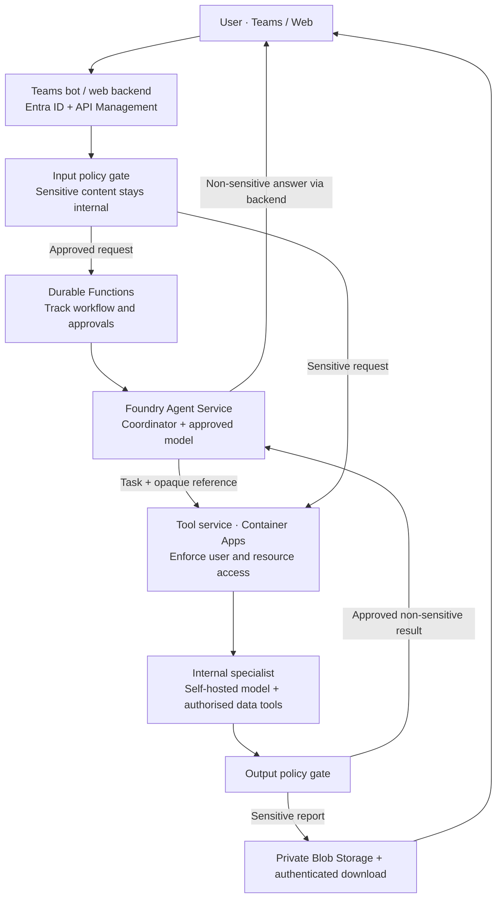

# Proposed architecture

Design snapshot: 27 October 2026. No services are deployed.

## Request and result flow

Arrows show logical data flow, not all network calls. Sensitive requests follow
the same tracking and authorisation rules; workflow payloads carry references
instead of raw customer data. The input gate is essential: a user can include
sensitive information in their initial message or attachment.

## Responsibilities

| Component | Responsibility |
| --- | --- |
| Teams bot / web backend | Verify the caller, bind identity to a conversation, invoke work and deliver responses. |
| Foundry coordinator | Run the model/tool loop with policy-approved context; request business operations or delegate. |
| Durable Functions | Coordinate long waits, approvals and recovery; keep side effects idempotent. Add Service Bus if separate worker dispatch is needed. |
| Tool services | Validate inputs and enforce operation-level and record-level permissions using trusted identity context. |
| Internal specialist | Process sensitive data using an internally hosted model in the bank-approved Azure boundary. Use independently authorised data tools. |
| Policy gates | Fail closed on unapproved content; govern inputs, tool outputs, errors and attachments before they enter managed model context. |
| Protected delivery | Store sensitive results privately and recheck the user's current access when serving them. Return only an approved status/reference to the coordinator. |

## Security and execution boundaries

- Bind verified user, tenant and run identity outside model-generated arguments.
  Reuse enterprise entitlements; do not create a parallel identity directory.
- Restrict an agent's available tools, and independently enforce permissions in
  every tool service. An agent identity alone does not establish the user's access.
- Keep banking credentials out of agent workers. Use managed identities where
  suitable and Key Vault for required service secrets. Use delegated access where
  supported; otherwise enforce user entitlements before service-identity access.
- Expose explicit business tools; do not register Bash, arbitrary code execution
  or unrestricted filesystem access. Tool wrappers may live beside the agent;
  privileged services are grouped by access and risk, not one container per tool.
- Treat skills, retrieved documents and model outputs as untrusted instructions
  or data. Skills do not grant permissions.
- Keep specialist transcripts, model traffic, intermediate results and telemetry
  within the approved sensitive-data boundary. Summaries are not automatically
  safe. Prefer allowlisted structured return fields; uncertain output stays internal.
- Restrict network egress with private networking and explicit destinations.
  Private endpoints do not remove model-service processing or retention concerns.
- Serialize work on a conversation, bound concurrent runs and child tasks, and
  persist progress outside worker lifetimes. Use stable task IDs and idempotency
  keys; recheck access after waits and when delivering results.
- Keep logs, traces, workflow histories and queues free of raw sensitive content
  by default. Audit identities, actions, decisions and approved references.

## Decisions still open

1. **Foundry agent type:** prompt agents provide a managed loop; hosted agents
   retain custom agent code. Pi is an alternative or hosted implementation option,
   not a required dependency of this design.
2. **Durability:** define the boundary between Foundry conversation state and
   Durable Functions business workflow state. Do not assume handler retries
   preserve arbitrary intermediate state or execute side effects exactly once.
3. **Specialist hosting:** select an approved model and suitable private compute
   after establishing data policy, capacity and operational requirements.
4. **Isolation:** assess managed Foundry isolation first. Firecracker is optional;
   using it on Azure requires verified KVM-capable hosting and a worker lifecycle.
5. **Data policy:** confirm whether the bank permits each data class in Foundry
   and its chosen model deployment. This design assumes sensitive customer data
   cannot enter the coordinator's managed model context; that is a design
   constraint from discussion, not a verified Rabobank policy.

## References

- [Foundry Agent Service](https://learn.microsoft.com/en-us/azure/foundry/agents/overview)
- [Foundry networking](https://learn.microsoft.com/en-us/azure/foundry/agents/concepts/agents-networking-deep-dive)
- [Foundry data handling](https://learn.microsoft.com/en-us/azure/foundry/responsible-ai/agents/data-privacy-security)
- [Hosted-agent resilience](https://learn.microsoft.com/en-us/azure/foundry/agents/concepts/long-running-agent-resilience)
- [Durable Task execution model](https://learn.microsoft.com/en-us/azure/azure-functions/durable/durable-functions-types-features-overview)
- [Pi](https://github.com/earendil-works/pi) and [Centaur](https://github.com/paradigmxyz/centaur): reference implementations inspected during the design discussion.

Feature availability, deployment regions and SDK compatibility must be verified
when implementation begins.
